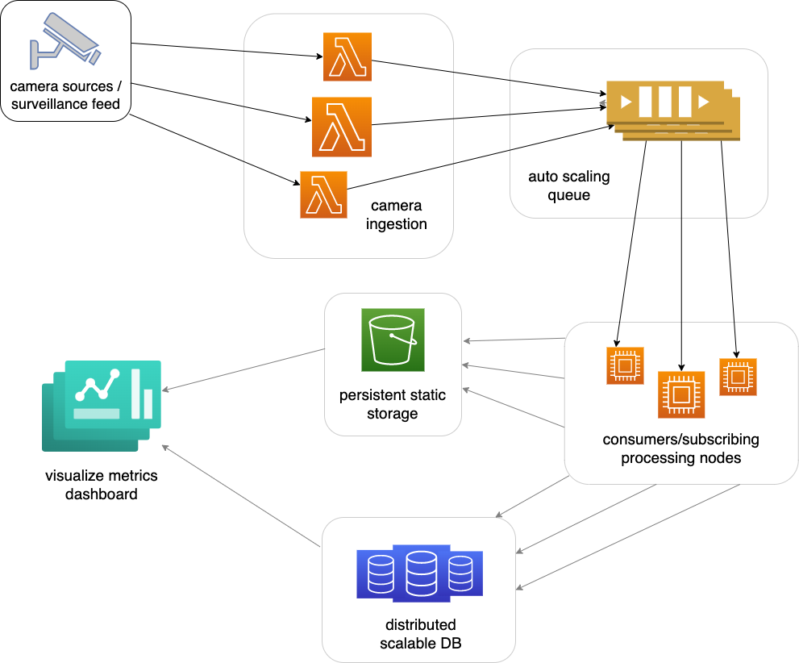

Tap into insights for brick and mortar

<object data="/files/athena-pitch-deck.pdf" type="application/pdf" width="100%" height="700px">
    <embed src="/files/athena-pitch-deck.pdf">
        
This browser does not support PDFs. Please download the PDF to view it: <a href="/files/athena-pitch-deck.pdf">Download PDF</a>.

    </embed>
</object>

Architecture for Athena

Democratizing public surveillance for a fair, just, and equitable dystopia

[jekyll-docs]: https://jekyllrb.com/docs/home
[jekyll-gh]:   https://github.com/jekyll/jekyll
[jekyll-talk]: https://talk.jekyllrb.com/
[http://athena.kinshug.com/]: http://athena.kinshug.com/