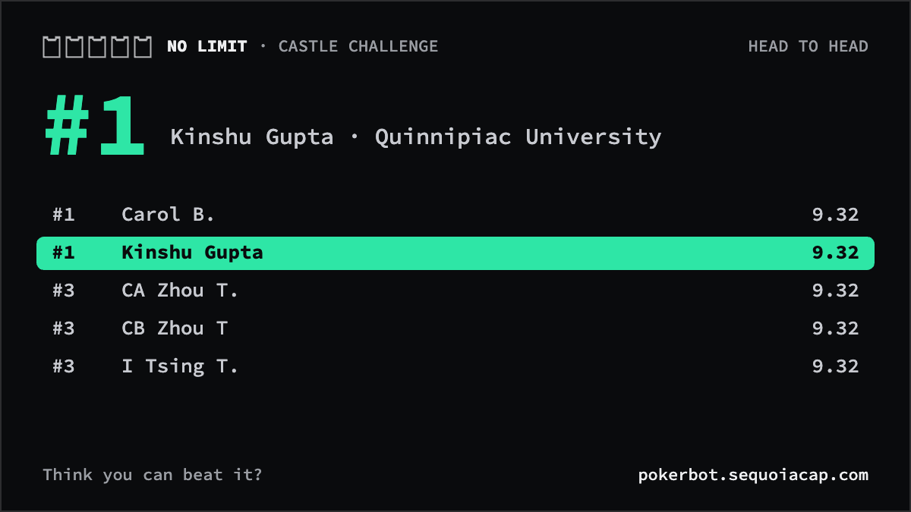
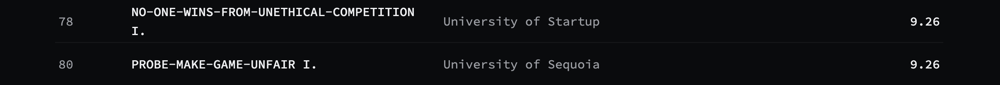

<link rel="stylesheet" href="/assets/castle/predictor.css">

I finished first in both games of the No Limit Castle Challenge, a strategy puzzle hosted by OpenAI, Citadel Securities and Sequoia in November 2026, with about six thousand entries.

| Game | My allocation | Leaderboards after my entry landed |
|---|---|---|
| Head to Head | 4-5-36-48-7 | 1st on all 105 |
| Four-Way | 3-41-54-1-1 | 1st on 31 of 105, more than any other entry |

<figure>

<figcaption>The card the site generated for my Head to Head entry on 7 November, the night of the deadline.</figcaption>
</figure>

The leaderboard was recomputed on a 15-minute clock and republished whenever something had changed. The counts cover the 105 versions published in the 45 hours after my entry appeared, on the last update before the Boston deadline.

Two caveats. In Head to Head, first place was shared: with one of my own measurement entries (explained below), and later with five entries that copied the allocation. Four-Way is scored on randomly drawn groups, so entries change order every time the board is recomputed. Mine was third on the first board, first more often than any other entry (the next best had 29), and never lower than tenth.

## The challenge

This is a Colonel Blotto game. You have 100 soldiers to split across five castles worth 1, 2, 3, 4 and 5 points. Everyone submits one allocation for each of two games.

**Head to Head.** Your allocation plays every other entry once. Each castle goes to whoever sent more soldiers, and a tie splits the points. Your score is your average points per opponent, out of 15.

**Four-Way.** Your allocation is grouped with three other entries. Each castle goes to the one entry of the four that sent the most soldiers there. The four are ranked by castle points and paid by place, with ties splitting:

| Place in the group | 1st | 2nd | 3rd | 4th |
|---|---|---|---|---|
| Payout | 9 | 4 | 2 | 0 |

The organisers draw 1,000,000 random groups of four from the field, and your score is your average payout, out of 9.

## Why there is no optimal answer

Every allocation loses to some other allocation: put 48 on castle 4 and someone with 49 takes it and spends the difference elsewhere. The best allocation depends on the entries actually submitted.

Those entries come from people reasoning about each other, usually described as level-k thinking: a level-0 player splits evenly or piles onto the big castles, level 1 best-responds to level 0, level 2 to level 1, and so on.

Formally, the field is an empirical joint distribution $$P$$ over the $$\binom{104}{4} = 4{,}598{,}126$$ ways to split 100 soldiers across five castles, and the task is to find the allocation with the highest expected score against an opponent drawn from it. $$P$$ is not published: the leaderboard shows each entry's score and nothing about its allocation. The problem is to infer $$P$$ from scores. Head to Head depends on $$P$$ only through its five marginal distributions, one per castle: how many soldiers the field sends to that castle, ignoring the rest of each entry.

<figure class="field-fig" style="overflow-x:auto">
<svg viewBox="62 38 1076 514" role="img" aria-label="For each of the five castles, the distribution of soldiers the field sent, with my entry marked: 4, 5, 36, 48 and 7" style="width:100%;min-width:600px;height:auto;font-family:var(--sans)">
<text x="70" y="78" font-size="40" font-weight="700" fill="var(--fg)" style="font-family:var(--serif)">Where the field put its soldiers, and where I put mine</text>
<path d="M230.0,178 L230.0,128.0 L242.9,133.5 L255.7,139.3 L268.6,143.3 L281.4,150.8 L294.3,158.4 L307.1,163.5 L320.0,166.6 L332.9,169.6 L345.7,172.0 L358.6,173.8 L371.4,175.3 L384.3,176.3 L397.1,176.8 L410.0,177.1 L422.9,177.1 L435.7,177.1 L448.6,177.0 L461.4,176.8 L474.3,176.7 L487.1,176.8 L500.0,176.8 L512.9,176.8 L525.7,177.1 L538.6,177.1 L551.4,177.2 L564.3,177.2 L577.1,177.3 L590.0,177.3 L602.9,177.5 L615.7,177.6 L628.6,177.6 L641.4,177.6 L654.3,177.6 L667.1,177.6 L680.0,177.6 L692.9,177.6 L705.7,177.6 L718.6,177.6 L731.4,177.6 L744.3,177.5 L757.1,177.4 L770.0,177.4 L782.9,177.4 L795.7,177.5 L808.6,177.6 L821.4,177.8 L834.3,177.7 L847.1,177.7 L860.0,177.6 L872.9,177.5 L885.7,177.5 L898.6,177.5 L911.4,177.5 L924.3,177.5 L937.1,177.5 L950.0,177.5 L962.9,177.4 L975.7,177.2 L988.6,177.3 L1001.4,177.4 L1014.3,177.5 L1027.1,177.6 L1040.0,177.8 L1052.9,177.8 L1065.7,177.6 L1078.6,177.5 L1091.4,177.5 L1104.3,177.5 L1117.1,177.4 L1130.0,177.6 L1130.0,178 Z" fill="var(--line)" fill-opacity=".55" stroke="var(--dim)" stroke-width="1.3"/>
<text x="70" y="160" font-size="23" font-weight="600" fill="var(--fg)">Castle 1</text>
<text x="70" y="180" font-size="15" fill="var(--dim)">1 point</text>
<line x1="281.4" y1="124" x2="281.4" y2="178" stroke="var(--acc)" stroke-width="3"/>
<circle cx="281.4" cy="124" r="7" fill="var(--acc)" stroke="var(--bg)" stroke-width="2"/>
<text x="294.4" y="132" font-size="23" font-weight="700" fill="var(--acc)" style="font-family:var(--mono)">4</text>
<path d="M230.0,256 L230.0,206.0 L242.9,213.2 L255.7,219.7 L268.6,223.7 L281.4,231.1 L294.3,236.4 L307.1,241.0 L320.0,242.9 L332.9,244.0 L345.7,244.6 L358.6,245.2 L371.4,244.4 L384.3,241.4 L397.1,240.0 L410.0,239.8 L422.9,240.1 L435.7,240.3 L448.6,243.7 L461.4,245.0 L474.3,247.3 L487.1,249.0 L500.0,250.1 L512.9,250.2 L525.7,251.5 L538.6,252.3 L551.4,252.9 L564.3,253.3 L577.1,253.9 L590.0,254.6 L602.9,254.9 L615.7,254.9 L628.6,255.0 L641.4,255.1 L654.3,255.1 L667.1,255.2 L680.0,255.0 L692.9,254.9 L705.7,255.0 L718.6,255.1 L731.4,255.2 L744.3,255.4 L757.1,255.6 L770.0,255.7 L782.9,255.7 L795.7,255.8 L808.6,255.8 L821.4,255.8 L834.3,255.9 L847.1,255.9 L860.0,255.9 L872.9,255.9 L885.7,255.9 L898.6,255.9 L911.4,255.9 L924.3,255.9 L937.1,255.9 L950.0,255.9 L962.9,255.9 L975.7,255.9 L988.6,255.9 L1001.4,255.9 L1014.3,256.0 L1027.1,256.0 L1040.0,255.7 L1052.9,255.7 L1065.7,255.7 L1078.6,255.7 L1091.4,255.6 L1104.3,255.9 L1117.1,255.9 L1130.0,255.9 L1130.0,256 Z" fill="var(--line)" fill-opacity=".55" stroke="var(--dim)" stroke-width="1.3"/>
<text x="70" y="238" font-size="23" font-weight="600" fill="var(--fg)">Castle 2</text>
<text x="70" y="258" font-size="15" fill="var(--dim)">2 points</text>
<line x1="294.3" y1="202" x2="294.3" y2="256" stroke="var(--acc)" stroke-width="3"/>
<circle cx="294.3" cy="202" r="7" fill="var(--acc)" stroke="var(--bg)" stroke-width="2"/>
<text x="307.3" y="210" font-size="23" font-weight="700" fill="var(--acc)" style="font-family:var(--mono)">5</text>
<path d="M230.0,334 L230.0,286.6 L242.9,287.4 L255.7,288.1 L268.6,286.5 L281.4,294.8 L294.3,299.8 L307.1,307.6 L320.0,315.3 L332.9,323.5 L345.7,326.9 L358.6,327.0 L371.4,327.1 L384.3,327.5 L397.1,329.9 L410.0,330.2 L422.9,329.3 L435.7,327.4 L448.6,326.1 L461.4,319.8 L474.3,312.9 L487.1,308.4 L500.0,303.8 L512.9,294.4 L525.7,286.1 L538.6,284.7 L551.4,284.0 L564.3,285.8 L577.1,291.6 L590.0,300.1 L602.9,303.2 L615.7,303.3 L628.6,302.2 L641.4,301.5 L654.3,300.7 L667.1,300.5 L680.0,305.2 L692.9,310.4 L705.7,314.9 L718.6,319.0 L731.4,324.1 L744.3,326.0 L757.1,327.1 L770.0,328.1 L782.9,330.7 L795.7,331.5 L808.6,331.6 L821.4,331.3 L834.3,331.7 L847.1,331.9 L860.0,331.6 L872.9,331.0 L885.7,331.7 L898.6,331.6 L911.4,331.7 L924.3,331.8 L937.1,332.1 L950.0,331.7 L962.9,331.9 L975.7,331.7 L988.6,332.1 L1001.4,332.5 L1014.3,333.0 L1027.1,333.2 L1040.0,333.6 L1052.9,333.7 L1065.7,333.7 L1078.6,333.7 L1091.4,333.7 L1104.3,333.6 L1117.1,333.6 L1130.0,333.6 L1130.0,334 Z" fill="var(--line)" fill-opacity=".55" stroke="var(--dim)" stroke-width="1.3"/>
<text x="70" y="316" font-size="23" font-weight="600" fill="var(--fg)">Castle 3</text>
<text x="70" y="336" font-size="15" fill="var(--dim)">3 points</text>
<line x1="692.9" y1="280" x2="692.9" y2="334" stroke="var(--acc)" stroke-width="3"/>
<circle cx="692.9" cy="280" r="7" fill="var(--acc)" stroke="var(--bg)" stroke-width="2"/>
<text x="705.9" y="288" font-size="23" font-weight="700" fill="var(--acc)" style="font-family:var(--mono)">36</text>
<path d="M230.0,412 L230.0,393.6 L242.9,390.1 L255.7,387.4 L268.6,387.9 L281.4,389.5 L294.3,391.7 L307.1,396.9 L320.0,403.2 L332.9,407.3 L345.7,408.7 L358.6,409.4 L371.4,409.3 L384.3,409.3 L397.1,409.3 L410.0,409.5 L422.9,409.9 L435.7,410.4 L448.6,410.2 L461.4,409.5 L474.3,405.4 L487.1,402.6 L500.0,399.8 L512.9,398.0 L525.7,396.5 L538.6,399.3 L551.4,400.0 L564.3,401.0 L577.1,401.1 L590.0,399.9 L602.9,395.2 L615.7,390.0 L628.6,382.9 L641.4,376.9 L654.3,368.3 L667.1,362.0 L680.0,362.0 L692.9,364.1 L705.7,366.9 L718.6,370.0 L731.4,374.2 L744.3,373.7 L757.1,374.8 L770.0,374.7 L782.9,378.4 L795.7,381.5 L808.6,383.0 L821.4,384.4 L834.3,388.5 L847.1,388.5 L860.0,388.9 L872.9,392.7 L885.7,395.5 L898.6,395.8 L911.4,400.3 L924.3,404.8 L937.1,406.6 L950.0,408.1 L962.9,409.0 L975.7,409.7 L988.6,410.0 L1001.4,410.7 L1014.3,410.3 L1027.1,410.6 L1040.0,410.7 L1052.9,410.2 L1065.7,410.3 L1078.6,410.8 L1091.4,410.6 L1104.3,410.6 L1117.1,411.2 L1130.0,411.1 L1130.0,412 Z" fill="var(--line)" fill-opacity=".55" stroke="var(--dim)" stroke-width="1.3"/>
<text x="70" y="394" font-size="23" font-weight="600" fill="var(--fg)">Castle 4</text>
<text x="70" y="414" font-size="15" fill="var(--dim)">4 points</text>
<line x1="847.1" y1="358" x2="847.1" y2="412" stroke="var(--acc)" stroke-width="3"/>
<circle cx="847.1" cy="358" r="7" fill="var(--acc)" stroke="var(--bg)" stroke-width="2"/>
<text x="860.1" y="366" font-size="23" font-weight="700" fill="var(--acc)" style="font-family:var(--mono)">48</text>
<path d="M230.0,490 L230.0,440.0 L242.9,447.4 L255.7,452.2 L268.6,454.4 L281.4,456.1 L294.3,461.2 L307.1,464.7 L320.0,468.5 L332.9,472.7 L345.7,479.6 L358.6,484.3 L371.4,485.5 L384.3,485.7 L397.1,486.3 L410.0,486.5 L422.9,486.7 L435.7,487.3 L448.6,487.6 L461.4,487.9 L474.3,487.3 L487.1,486.2 L500.0,484.9 L512.9,484.1 L525.7,483.9 L538.6,484.4 L551.4,485.5 L564.3,486.7 L577.1,487.4 L590.0,487.1 L602.9,485.1 L615.7,481.8 L628.6,478.8 L641.4,474.9 L654.3,471.6 L667.1,467.8 L680.0,465.5 L692.9,464.5 L705.7,464.1 L718.6,455.8 L731.4,452.4 L744.3,452.9 L757.1,450.8 L770.0,447.8 L782.9,451.4 L795.7,457.3 L808.6,460.3 L821.4,464.1 L834.3,469.3 L847.1,471.4 L860.0,462.2 L872.9,454.4 L885.7,452.3 L898.6,450.4 L911.4,450.1 L924.3,457.9 L937.1,464.6 L950.0,466.1 L962.9,467.4 L975.7,471.9 L988.6,472.9 L1001.4,474.4 L1014.3,475.7 L1027.1,477.7 L1040.0,479.8 L1052.9,483.2 L1065.7,483.7 L1078.6,484.7 L1091.4,485.1 L1104.3,485.2 L1117.1,485.7 L1130.0,485.8 L1130.0,490 Z" fill="var(--line)" fill-opacity=".55" stroke="var(--dim)" stroke-width="1.3"/>
<text x="70" y="472" font-size="23" font-weight="600" fill="var(--fg)">Castle 5</text>
<text x="70" y="492" font-size="15" fill="var(--dim)">5 points</text>
<line x1="320.0" y1="436" x2="320.0" y2="490" stroke="var(--acc)" stroke-width="3"/>
<circle cx="320.0" cy="436" r="7" fill="var(--acc)" stroke="var(--bg)" stroke-width="2"/>
<text x="333.0" y="444" font-size="23" font-weight="700" fill="var(--acc)" style="font-family:var(--mono)">7</text>
<text x="230.0" y="514" text-anchor="middle" font-size="15" fill="var(--dim)">0</text>
<text x="358.6" y="514" text-anchor="middle" font-size="15" fill="var(--dim)">10</text>
<text x="487.1" y="514" text-anchor="middle" font-size="15" fill="var(--dim)">20</text>
<text x="615.7" y="514" text-anchor="middle" font-size="15" fill="var(--dim)">30</text>
<text x="744.3" y="514" text-anchor="middle" font-size="15" fill="var(--dim)">40</text>
<text x="872.9" y="514" text-anchor="middle" font-size="15" fill="var(--dim)">50</text>
<text x="1001.4" y="514" text-anchor="middle" font-size="15" fill="var(--dim)">60</text>
<text x="1130.0" y="514" text-anchor="middle" font-size="15" fill="var(--dim)">70</text>
<text x="1130" y="536" text-anchor="end" font-size="15" fill="var(--dim)">soldiers sent to the castle</text>
</svg>
<figcaption>The shape for each castle is the field, as fitted by the model described below. The marker is my entry.</figcaption>
</figure>

## Probes

The leaderboard shows scores and hides allocations. But I know the allocation of any entry I submit, so each of my own entries is an exact fact about the field: this allocation scores this much. I call an entry submitted for that purpose a probe.

The Head to Head payoff is separable: it is a sum of one term per castle. Let the random variable $$X_c$$ be the number of soldiers an opponent sends to castle $$c$$. The score of an allocation $$a = (a_1, \dots, a_5)$$ is

$$
\begin{aligned}
S(a) = {} & 1 \cdot F_1(a_1) + 2 \cdot F_2(a_2) + 3 \cdot F_3(a_3) \\
& + 4 \cdot F_4(a_4) + 5 \cdot F_5(a_5)
\end{aligned}
$$

where $$F_c(x)$$ is the share of the field that $$x$$ soldiers beat on castle $$c$$, counting ties as half:

$$
F_c(x) = \Pr[X_c < x] + \tfrac{1}{2} \Pr[X_c = x]
$$

$$F_c$$ is close to the cumulative distribution function of the marginal on castle $$c$$. The difference is ties: the CDF, $$\Pr[X_c \le x]$$, counts them in full, and $$F_c$$ counts them as half, because a tie splits the castle. The score depends on the field only through $$F_1, \dots, F_5$$. An entry with soldiers on only one or two castles isolates one or two values of $$F_c$$ in its published score.

### All-in entries

Five probes each put all 100 soldiers on one castle. On the leaderboard of 7 November, 03:06 UTC, two hours before the deadline, the one on castle 5 scored 5.613. Its score has two parts.

- **Castle 5.** It beats every opponent except the 37 other entries that also sent all 100 there, which tie it and split the 5 points. Those 37 are 0.64% of its 5,738 opponents, and they are easy to count: they have the identical score. That gives $$5 \cdot (0.9936 + \tfrac{1}{2} \cdot 0.0064) = 4.984$$ points.
- **Castles 1 to 4.** It sent zero, so it gets half of a castle's points from each opponent that also sent zero there. Write $$z_c$$ for the share of the field sending zero to castle $$c$$.

$$
5.613 = 4.984 + \tfrac{1}{2} \left( 1 z_1 + 2 z_2 + 3 z_3 + 4 z_4 \right)
$$

Each of the five all-in entries gives one equation of this kind. An entry's equation leaves out its own castle, so no single entry gives any $$z_c$$:

| All 100 on | Score | Entries with that score | Its equation contains |
|---|---|---|---|
| Castle 1 | 1.935 | 7 | $$z_2, z_3, z_4, z_5$$ |
| Castle 2 | 2.847 | 6 | $$z_1, z_3, z_4, z_5$$ |
| Castle 3 | 3.802 | 10 | $$z_1, z_2, z_4, z_5$$ |
| Castle 4 | 4.737 | 22 | $$z_1, z_2, z_3, z_5$$ |
| Castle 5 | 5.613 | 38 | $$z_1, z_2, z_3, z_4$$ |

Five equations, five unknowns. Solved together they give the share of the field sending zero to each castle:

$$
z_1 = 11.0\%, \quad z_2 = 14.2\%, \quad z_3 = 12.4\%, \quad z_4 = 12.3\%, \quad z_5 = 14.4\%
$$

That fixes each $$F_c$$ at zero.

### Single-castle entries

The rest of each $$F_c$$ comes from a second kind of probe: soldiers on one castle, the rest parked on castle 1. For example, 59-0-0-41-0 scored 4.501.

- Castles 2, 3 and 5, with zero soldiers, can only tie, and a tie is worth half: $$F_c(0) = \tfrac{1}{2} \Pr[X_c = 0] = z_c / 2$$, already measured. Together they contribute 0.689 points.
- The rest comes from castles 1 and 4.

$$
1 \cdot F_1(59) + 4 \cdot F_4(41) = 4.501 - 0.689 = 3.812
$$

That is one equation in two unknowns. Parking 59 soldiers on castle 1 nearly always wins it, but not always: about 5% of the field sends more. So a single probe does not give $$F_4(41)$$ on its own. It ties it to $$F_1(59)$$.

About eighty such entries covered all five castles, each one an equation of this kind. The model in the next section solves them together. It puts $$F_1(59)$$ at 0.95 and $$F_4(41)$$ at 0.72: 41 soldiers on castle 4 beat 72% of the field.

## A model of the field

Each probe is an equation about the field, not a direct reading of it. To solve them together, and to fill in between them, I fitted a model of $$P$$ that agrees with every probe and with the published scores.

### The prior

The model is a crowd of about 290,000 particles: allocations drawn uniformly at random from all the possible ones. Particle $$i$$ has an allocation $$b_i = (b_{i,1}, \dots, b_{i,5})$$ and a weight $$w_i$$, its share of the field. The weights sum to 1 and start equal.

A uniform draw assumes nothing about how people play. My first prior did: round-number splits and a few shapes a person might plausibly choose. It predicted badly. An entry of 20 soldiers on every castle was predicted to score 7.8 and scored 6.13. I then compared eight priors on three known entries held out of the fit. The uniform one was off by 0.11, and the seven human-shaped ones by 0.33 to 0.60. The less the prior assumed, the better it predicted.

### Fitting the weights

The link between the hidden allocations and the visible scores is this: the leaderboard is the field playing itself. If the model's crowd is right, then playing it against itself must reproduce the real leaderboard's scores, the measured zero shares, and the score of every probe. The weights are adjusted in a loop until it does. One pass has four steps, and the loop runs 300 passes.

<figure class="loop-fig" style="overflow-x:auto">
<svg viewBox="0 0 680 232" role="img" aria-label="The four steps of the fitting loop in a row, with an arrow returning from the last step to the first" style="width:100%;min-width:560px;height:auto;font:13px var(--sans)">
<defs><marker id="loop-ah" viewBox="0 0 10 10" refX="9" refY="5" markerWidth="7" markerHeight="7" orient="auto-start-reverse"><path d="M0,0 L10,5 L0,10 z" fill="var(--fg)"/></marker></defs>
<text x="1" y="18" font-weight="600" font-size="14" fill="var(--fg)">The crowd: 290,000 particles, each with a weight</text>
<rect x="1" y="36" width="150" height="112" rx="4" fill="none" stroke="var(--dim)" stroke-width="1"/>
<text x="13" y="60" font-weight="700" font-size="15" fill="var(--acc)">1</text>
<text x="29" y="60" font-weight="600" font-size="13.5" fill="var(--fg)">Score the crowd</text>
<text x="29" y="77" font-weight="600" font-size="13.5" fill="var(--fg)">against itself</text>
<text x="13" y="104" font-size="12" fill="var(--dim)">a score for every</text>
<text x="13" y="120" font-size="12" fill="var(--dim)">particle</text>
<rect x="177" y="36" width="150" height="112" rx="4" fill="none" stroke="var(--dim)" stroke-width="1"/>
<text x="189" y="60" font-weight="700" font-size="15" fill="var(--acc)">2</text>
<text x="205" y="60" font-weight="600" font-size="13.5" fill="var(--fg)">Match the score</text>
<text x="205" y="77" font-weight="600" font-size="13.5" fill="var(--fg)">distribution</text>
<text x="189" y="104" font-size="12" fill="var(--dim)">against the real</text>
<text x="189" y="120" font-size="12" fill="var(--dim)">leaderboard's scores</text>
<rect x="353" y="36" width="150" height="112" rx="4" fill="none" stroke="var(--dim)" stroke-width="1"/>
<text x="365" y="60" font-weight="700" font-size="15" fill="var(--acc)">3</text>
<text x="381" y="60" font-weight="600" font-size="13.5" fill="var(--fg)">Match the zero</text>
<text x="381" y="77" font-weight="600" font-size="13.5" fill="var(--fg)">shares</text>
<text x="365" y="104" font-size="12" fill="var(--dim)">against the five</text>
<text x="365" y="120" font-size="12" fill="var(--dim)">all-in probes</text>
<rect x="529" y="36" width="150" height="112" rx="4" fill="none" stroke="var(--dim)" stroke-width="1"/>
<text x="541" y="60" font-weight="700" font-size="15" fill="var(--acc)">4</text>
<text x="557" y="60" font-weight="600" font-size="13.5" fill="var(--fg)">Match each</text>
<text x="557" y="77" font-weight="600" font-size="13.5" fill="var(--fg)">probe</text>
<text x="541" y="104" font-size="12" fill="var(--dim)">against each probe's</text>
<text x="541" y="120" font-size="12" fill="var(--dim)">real score</text>
<path d="M151,92 L175,92" stroke="var(--fg)" stroke-width="1.4" fill="none" marker-end="url(#loop-ah)"/>
<path d="M327,92 L351,92" stroke="var(--fg)" stroke-width="1.4" fill="none" marker-end="url(#loop-ah)"/>
<path d="M503,92 L527,92" stroke="var(--fg)" stroke-width="1.4" fill="none" marker-end="url(#loop-ah)"/>
<path d="M604,148 L604,190 L76,190 L76,150" stroke="var(--fg)" stroke-width="1.4" fill="none" marker-end="url(#loop-ah)"/>
<text x="340" y="212" text-anchor="middle" font-size="12" fill="var(--dim)">300 passes, until all the evidence holds at once</text>
</svg>
</figure>

**1. Score the crowd against itself.** The current weights give the crowd's five marginals: for each castle, the share of weight on each number of soldiers. From those come $$F_1, \dots, F_5$$, and with them a score for every particle. $$s_i$$ is the Head to Head score particle $$i$$ would get if it were entered against this crowd:

$$
s_i = \sum_{c=1}^{5} c \cdot F_c(b_{i,c})
$$

where $$b_{i,c}$$ is the number of soldiers particle $$i$$ sends to castle $$c$$. There is one score per particle, about 290,000 in all, just as the real leaderboard has one score per entry. Together they are the model's version of the leaderboard.

**2. Match the score distribution.** Sort scores into bins 0.05 wide. Let $$h(B)$$ be the share of real leaderboard scores in bin $$B$$, and $$m(B)$$ the total weight of the particles whose score falls in it. Each particle is rescaled by how far its bin is off:

$$
w_i \leftarrow w_i \left( \frac{h(B_i)}{m(B_i)} \right)^{0.3}
$$

Where the model has too much weight in a bin the particles in it shrink, and where too little they grow. Say 4% of real scores fall between 7.00 and 7.05 but the model has 8% of its weight there. The ratio is 0.5, and $$0.5^{0.3} = 0.81$$, so every particle in that bin loses 19% of its weight.

The exponent 0.3 is there because the target moves. Changing the weights changes the marginals, which changes every particle's score in step 1, so particles shift between bins. A full correction would overshoot. A partial one, repeated, settles.

**3. Match the zero shares.** This is the same adjustment as step 2, applied to a different quantity. For each castle $$c$$ there are two numbers: $$q_c$$, the model's share sending zero there (the total weight of the particles with zero on castle $$c$$), and $$z_c$$, the real share measured by the all-in probes. The particles that send zero are rescaled by the ratio of real to model, and the rest by the ratio for the complement, with the same damping:

$$
w_i \leftarrow
\begin{cases}
w_i \left( z_c / q_c \right)^{0.3} & \text{if } b_{i,c} = 0 \\
w_i \left( (1 - z_c) / (1 - q_c) \right)^{0.3} & \text{otherwise}
\end{cases}
$$

If the crowd has 6% sending zero to castle 5 and the measured share is 13.9%, the zero-senders are multiplied by $$(13.9 / 6)^{0.3} = 1.29$$ and everyone else by $$(86.1 / 94)^{0.3} = 0.97$$.

**4. Match each probe.** A probe is an entry whose allocation and real score $$y$$ are both known. Take the calibration entry, 20-20-20-20-20, with $$y = 6.13$$. Everything in this step is built from one quantity:

$$
g_i = \text{the probe's score against particle } i \text{ alone}
$$

Against the particle 0-0-0-45-55, for example, the probe wins castles 1, 2 and 3, so $$g_i = 6$$.

The model's score for the probe is the average of $$g_i$$ over the crowd, each particle counted by its weight:

$$
\hat{y} = \sum_i w_i \, g_i
$$

The crowd is right about this probe only if $$\hat{y} = y$$. Under my first prior it was not: $$\hat{y} = 7.8$$ against $$y = 6.13$$. A model score that is too high means too much weight on particles with a large $$g_i$$, the ones the probe beats heavily.

To correct it, every weight is multiplied by a factor that depends on its $$g_i$$, then rescaled so the weights sum to 1:

$$
w_i \leftarrow \frac{w_i \, e^{\lambda g_i}}{\sum_j w_j \, e^{\lambda g_j}}
$$

One number, $$\lambda$$, sets the direction and the strength. With $$\lambda = -0.1$$, a particle with $$g_i = 12$$ is multiplied by $$e^{-1.2} = 0.30$$ and one with $$g_i = 3$$ by $$e^{-0.3} = 0.74$$. Weight moves from the opponents the probe crushes to the ones it struggles against, and $$\hat{y}$$ falls. A positive $$\lambda$$ does the opposite.

$$\hat{y}$$ rises steadily as $$\lambda$$ rises, so exactly one value gives $$\hat{y} = y$$, and bisection finds it. Of all the reweightings that reach $$y$$, this one, an exponential tilt, changes the weights least.

The probes are handled one at a time, in order, each with its own $$\lambda$$. A tilt for one probe disturbs the others, so no probe is matched exactly in a single pass: each tilt is applied at 0.3 of its full strength, and the 300 passes let all of them settle together. By the end the model reproduced the probes' scores to within 0.004 on average.

The four steps disturb each other: fixing a probe shifts the score distribution, and fixing the distribution shifts the probes. That is why it is a loop. It stops changing when all the evidence holds at once.

Every step multiplies the starting weights. A kind of entry the prior left out can never appear, and wherever the evidence is silent the prior decides.

### Using the fitted field

The fitted field gives the five marginals. With those, the separable formula scores all 4,598,126 allocations, and the best one is the candidate. Repeating the whole fit on resampled leaderboard scores, with a fresh set of particles each time, gives a range for each prediction.

The curves below are the five $$F_c$$ from the fit to the leaderboard of 7 November, 03:06 UTC. Set an allocation and the page computes its score from them.

### Checking it

The fit reproduces the 146 entries it was fitted to with a typical error of 0.006, as it should. The real test is entries it had not seen. Eight of my entries, with allocations the fit had never been given, appeared on the leaderboard after it was made. The model's scores for them, against the scores the leaderboard gave:

All eight are within 0.009. My final entry repeats an allocation the fit already knew; the model gives it 9.316 and the leaderboard gave it 9.320.

## Search

Fitted with the probes I had by then, the model put the best allocation at 4-4-36-48-8 and predicted a score of 9.19 ± 0.03. On the leaderboard it scored 9.290 and ranked 30th.

From there I searched on the leaderboard, one round per update. A round works like this:

1. Take the best entry so far as the base.
2. Submit about eight neighbours of it. A neighbour is the base with one soldier moved from one castle to another.
3. On the next update, compare each neighbour's score with the base's score on the same board. Head to Head scores are exact, so the difference is exactly what that one move is worth.
4. If a neighbour beats the base, it becomes the new base. The losses matter too: a move that costs a lot marks a direction to leave alone, and one that costs almost nothing is worth trying again in combination.

Because the score is separable, each difference says two things at once: what the last soldier is worth on the castle it left, and what one more is worth on the castle it joined.

<figure class="search-fig" style="overflow-x:auto">
<svg viewBox="0 0 660 651" role="img" aria-label="For each of the two base entries, the change in score from moving soldiers between castles" style="width:100%;min-width:560px;height:auto;font:12.5px var(--sans)">
<text x="0" y="18" font-weight="600" fill="var(--fg)">From 4-4-36-48-8</text>
<text x="128" y="18" fill="var(--dim)">scoring 9.283 to 9.287 · 13 moves tried</text>
<text x="660" y="18" text-anchor="end" fill="var(--dim)" font-style="italic">the best move becomes the new base</text>
<text x="0" y="41" fill="var(--fg)" font-weight="600">castle 5 → castle 2</text>
<rect x="507.0" y="31" width="74.4" height="11" rx="2" fill="var(--acc)"/>
<text x="586.4" y="41" fill="var(--fg)" font-weight="600">+0.020</text>
<text x="0" y="62" fill="var(--fg)">castle 5 → castle 1</text>
<rect x="507.0" y="52" width="67.0" height="11" rx="2" fill="var(--acc)"/>
<text x="579.0" y="62" fill="var(--fg)">+0.018</text>
<text x="0" y="83" fill="var(--fg)">castle 5 → castle 3</text>
<rect x="507.0" y="73" width="11.2" height="11" rx="2" fill="var(--acc)"/>
<text x="523.2" y="83" fill="var(--fg)">+0.003</text>
<text x="0" y="104" fill="var(--fg)">castle 5 → castle 4</text>
<rect x="499.6" y="94" width="7.4" height="11" rx="2" fill="var(--dim)"/>
<text x="494.6" y="104" text-anchor="end" fill="var(--dim)">−0.002</text>
<text x="0" y="125" fill="var(--fg)">castle 4 → castle 2</text>
<rect x="495.8" y="115" width="11.2" height="11" rx="2" fill="var(--dim)"/>
<text x="490.8" y="125" text-anchor="end" fill="var(--dim)">−0.003</text>
<text x="0" y="146" fill="var(--fg)">castle 4 → castle 1</text>
<rect x="488.4" y="136" width="18.6" height="11" rx="2" fill="var(--dim)"/>
<text x="483.4" y="146" text-anchor="end" fill="var(--dim)">−0.005</text>
<text x="0" y="167" fill="var(--fg)">5 → 1 and 5 → 2</text>
<rect x="447.5" y="157" width="59.5" height="11" rx="2" fill="var(--dim)"/>
<text x="442.5" y="167" text-anchor="end" fill="var(--dim)">−0.016</text>
<text x="0" y="188" fill="var(--fg)">castle 4 → castle 3</text>
<rect x="428.9" y="178" width="78.1" height="11" rx="2" fill="var(--dim)"/>
<text x="423.9" y="188" text-anchor="end" fill="var(--dim)">−0.021</text>
<text x="0" y="209" fill="var(--fg)">castle 3 → castle 4</text>
<rect x="395.4" y="199" width="111.6" height="11" rx="2" fill="var(--dim)"/>
<text x="390.4" y="209" text-anchor="end" fill="var(--dim)">−0.030</text>
<text x="0" y="230" fill="var(--fg)">castle 4 → castle 5</text>
<rect x="332.2" y="220" width="174.8" height="11" rx="2" fill="var(--dim)"/>
<text x="327.2" y="230" text-anchor="end" fill="var(--dim)">−0.047</text>
<text x="0" y="251" fill="var(--fg)">castle 2 → castle 4</text>
<rect x="321.0" y="241" width="186.0" height="11" rx="2" fill="var(--dim)"/>
<text x="316.0" y="251" text-anchor="end" fill="var(--dim)">−0.050</text>
<text x="0" y="272" fill="var(--fg)">5 → 4 and 5 → 4</text>
<rect x="309.8" y="262" width="197.2" height="11" rx="2" fill="var(--dim)"/>
<text x="304.8" y="272" text-anchor="end" fill="var(--dim)">−0.053</text>
<text x="0" y="293" fill="var(--fg)">castle 1 → castle 5</text>
<rect x="246.6" y="283" width="260.4" height="11" rx="2" fill="var(--dim)"/>
<text x="241.6" y="293" text-anchor="end" fill="var(--dim)">−0.070</text>
<line x1="507.0" y1="28" x2="507.0" y2="297" stroke="var(--fg)" stroke-width="1"/>
<text x="0" y="333" font-weight="600" fill="var(--fg)">From 4-5-36-48-7</text>
<text x="128" y="333" fill="var(--dim)">scoring 9.299 to 9.301 · 14 moves tried</text>
<text x="660" y="333" text-anchor="end" fill="var(--dim)" font-style="italic">the one gain ties for first</text>
<text x="0" y="356" fill="var(--fg)" font-weight="600">castle 4 → castle 2</text>
<rect x="507.0" y="346" width="11.2" height="11" rx="2" fill="var(--acc)"/>
<text x="523.2" y="356" fill="var(--fg)" font-weight="600">+0.003</text>
<text x="0" y="377" fill="var(--fg)">3 → 2 and 4 → 2</text>
<rect x="507.0" y="367" width="1.5" height="11" rx="2" fill="var(--dim)"/>
<text x="512.0" y="377" fill="var(--fg)">0.000</text>
<text x="0" y="398" fill="var(--fg)">castle 3 → castle 2</text>
<rect x="503.3" y="388" width="3.7" height="11" rx="2" fill="var(--dim)"/>
<text x="498.3" y="398" text-anchor="end" fill="var(--dim)">−0.001</text>
<text x="0" y="419" fill="var(--fg)">castle 4 → castle 1</text>
<rect x="477.2" y="409" width="29.8" height="11" rx="2" fill="var(--dim)"/>
<text x="472.2" y="419" text-anchor="end" fill="var(--dim)">−0.008</text>
<text x="0" y="440" fill="var(--fg)">3 → 1 and 4 → 2</text>
<rect x="473.5" y="430" width="33.5" height="11" rx="2" fill="var(--dim)"/>
<text x="468.5" y="440" text-anchor="end" fill="var(--dim)">−0.009</text>
<text x="0" y="461" fill="var(--fg)">castle 3 → castle 1</text>
<rect x="462.4" y="451" width="44.6" height="11" rx="2" fill="var(--dim)"/>
<text x="457.4" y="461" text-anchor="end" fill="var(--dim)">−0.012</text>
<text x="0" y="482" fill="var(--fg)">castle 1 → castle 2</text>
<rect x="451.2" y="472" width="55.8" height="11" rx="2" fill="var(--dim)"/>
<text x="446.2" y="482" text-anchor="end" fill="var(--dim)">−0.015</text>
<text x="0" y="503" fill="var(--fg)">4 → 1 and 4 → 2</text>
<rect x="443.8" y="493" width="63.2" height="11" rx="2" fill="var(--dim)"/>
<text x="438.8" y="503" text-anchor="end" fill="var(--dim)">−0.017</text>
<text x="0" y="524" fill="var(--fg)">2 → 1 and 4 → 1</text>
<rect x="432.6" y="514" width="74.4" height="11" rx="2" fill="var(--dim)"/>
<text x="427.6" y="524" text-anchor="end" fill="var(--dim)">−0.020</text>
<text x="0" y="545" fill="var(--fg)">castle 4 → castle 3</text>
<rect x="425.2" y="535" width="81.8" height="11" rx="2" fill="var(--dim)"/>
<text x="420.2" y="545" text-anchor="end" fill="var(--dim)">−0.022</text>
<text x="0" y="566" fill="var(--fg)">castle 3 → castle 4</text>
<rect x="391.7" y="556" width="115.3" height="11" rx="2" fill="var(--dim)"/>
<text x="386.7" y="566" text-anchor="end" fill="var(--dim)">−0.031</text>
<text x="0" y="587" fill="var(--fg)">3 → 1 and 3 → 4</text>
<rect x="361.9" y="577" width="145.1" height="11" rx="2" fill="var(--dim)"/>
<text x="356.9" y="587" text-anchor="end" fill="var(--dim)">−0.039</text>
<text x="0" y="608" fill="var(--fg)">4 → 1 and 4 → 3</text>
<rect x="347.0" y="598" width="160.0" height="11" rx="2" fill="var(--dim)"/>
<text x="342.0" y="608" text-anchor="end" fill="var(--dim)">−0.043</text>
<text x="0" y="629" fill="var(--fg)">3 → 4 and 3 → 4</text>
<rect x="306.1" y="619" width="200.9" height="11" rx="2" fill="var(--dim)"/>
<text x="301.1" y="629" text-anchor="end" fill="var(--dim)">−0.054</text>
<line x1="507.0" y1="343" x2="507.0" y2="633" stroke="var(--fg)" stroke-width="1"/>
</svg>
<figcaption>Each bar is one neighbour: the base entry with soldiers moved between castles, and what that did to the score. Gains point right.</figcaption>
</figure>

From the first base, taking a soldier from castle 4 or castle 1 always cost. Taking one from castle 5 gained, most when it went to castle 2, and that entry became the new base. From there only one move gained, castle 4 to castle 2, and it tied for first.

That took four leaderboard updates, under three hours, and 32 entries, 27 of which reached the leaderboard. The entry it tied with had held that score since the day before. By the evening of the deadline the field had shifted and its neighbour 4-5-36-48-7 had overtaken it; I submitted that one under my name.

## Four-Way

Four-Way is not separable. The payout depends on place in the group, which depends on all five castles and all three opponents, so it depends on the joint distribution (which numbers go together within an entry) and the marginals are not enough. Single-castle entries measure nothing.

A rebuilt Four-Way model supplied a starting region, 8-41-51-0-0, which ranked 102nd. From there I used the same neighbour search, on averages. The same entry's score has a standard deviation of about 0.013 from one board to the next, more than the gap between good neighbours. Over 24 boards, 3-41-54-1-1 averaged 6.003 and its two closest neighbours 6.000 and 5.997: a plateau, where first place on any one board is a draw.

The Four-Way model is a different fit from the Head to Head one, because a payout depends on three opponents at once. It gets its own write-up in part two, which will be linked here once it is published.

## Closing notes

I was not the only one measuring. About 240 of the 6,038 Head to Head entries on the final leaderboard came from four scripted series, and two early entries were named `PROBE-MAKE-GAME-UNFAIR` and `NO-ONE-WINS-FROM-UNETHICAL-COMPETITION`.

<figure>

<figcaption>Two entries on the Head to Head leaderboard, 5 November. Both ranked between 73rd and 106th until the organisers removed them.</figcaption>
</figure>

That raised a question I kept returning to: a score never proves an allocation, so an entry labelled as a measurement could be built to mislead anyone who trusted it, which is why only my own entries counted as evidence.

An entry did not need to deceive to matter, either. Every score is an average over the whole field, so anyone willing to submit in bulk could move all of them. Each added entry can shift the gap between two others by up to 15 divided by the field size, about 0.003 here, and on the deadline leaderboard the top eleven entries were within 0.01 of each other. I saved all 319 versions of the leaderboard to watch for it. They show the organisers removing entries twice, 44 and then 71, and a batch of 100 arriving at once after the deadline that lowered the top score from 9.316 to 9.300 without changing the order at the top.

This was evening work: after my day job, usually until about midnight, with an occasional steer from my phone during lunch, through Claude Code's Remote Control. I directed the work and Claude Code, running as an agent, did most of the execution: collecting every version of the leaderboard, fitting the model, and running the submit-and-measure loop overnight.

