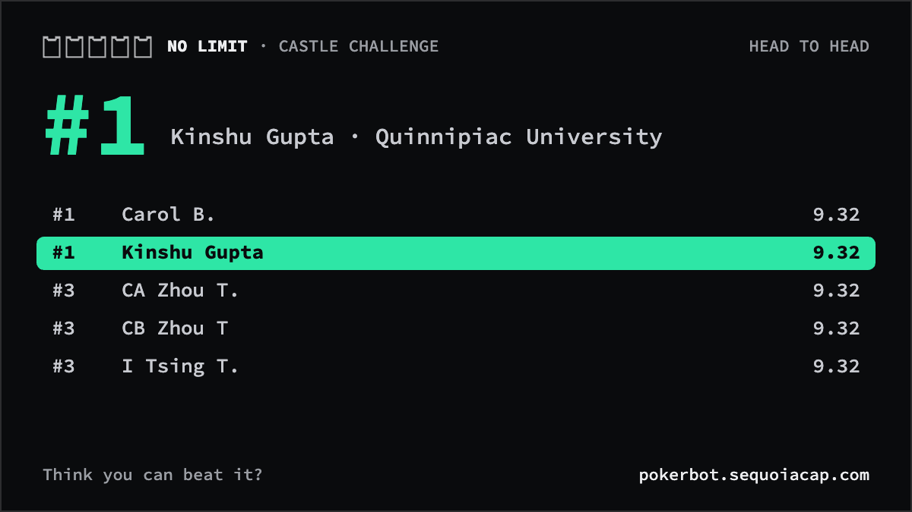

I finished first in both games of Sequoia's No Limit Castle Challenge, a strategy puzzle with about six thousand entries, run in November 2026.

| Game | My allocation | Leaderboards after my entry landed |
|---|---|---|
| Head to Head | 4-5-36-48-7 | 1st on all 105 |
| Four-Way | 3-41-54-1-1 | 1st on 31 of 105, more than any other entry |

<figure>


<figcaption>The cards the site generated for my entry on 7 November, the night of the deadline.</figcaption>
</figure>

The leaderboard was recomputed about every half hour. These are the 105 versions published in the 45 hours after my entry appeared, which was the last update before the Boston deadline.

Two caveats. In Head to Head, first place was shared: on the deadline board with one other entry, which was one of my own measurement entries (explained below), and later with five people who copied the allocation. Four-Way is scored by random sampling, so the same entries change order every time the board is recomputed. A handful of entries sat within that noise at the top. Mine was third on the first board, first more often than any other entry (the next best had 29), and never lower than tenth.

## The challenge

You have 100 soldiers to split across five castles worth 1, 2, 3, 4 and 5 points. Everyone submits one allocation for each of two games.

- **Head to Head.** Your allocation plays every other entry once. Each castle goes to whoever sent more soldiers, and a tie splits the points. Your score is your average points per opponent, out of 15.
- **Four-Way.** You are grouped with three other entries, and each castle goes to the single highest sender of the four. The organisers score this by sampling random groups.

## Why there is no optimal answer

Every allocation loses to some other allocation. Put 48 on castle 4 and someone with 49 takes it from you and spends the difference elsewhere. So there is no best allocation in general, only a best allocation against the entries that were actually submitted.

Those entries come from people reasoning about each other. This is usually described as level-k thinking: a level-0 player splits evenly or piles onto the big castles, a level-1 player picks the best response to level 0, a level-2 player responds to level 1, and so on. The real problem is to find out what mix of levels the field is playing. I tried to model that mix, and then found a way to measure it.

## Approach 1: a fitted model of the field

The leaderboard publishes every entry's score but not its allocation. My first approach was to build a model of the field from those scores: a large set of candidate allocations, each with a weight, fitted so that the model reproduced the published distribution of scores and the exact scores of the few entries whose allocations I knew.

It was wrong where it mattered. A calibration entry of 20 soldiers on every castle was predicted to score between 7.7 and 8.5 and scored 6.13. Three of the first four entries the model chose came in 0.5 to 0.7 below its prediction. Its picture of castle 4 was the clearest miss: it said 41 soldiers there would beat 87% of the field. The measured figure, from the method below, was 71%.

Many different fields produce the same distribution of scores, and the model had picked one that was softer at the top than the real one. I spent two days on it.

## Approach 2: measuring the field

Head to Head scores add up castle by castle. For an allocation a:

```
score(a) = 1·F1(a1) + 2·F2(a2) + 3·F3(a3) + 4·F4(a4) + 5·F5(a5)
```

where `Fc(x)` is the share of the field that x soldiers beat on castle c, counting ties as half. Nothing about one castle affects another. So an entry that puts soldiers on a single castle reads off one value of one `F`, straight from its published score.

One example. I submitted 59-0-0-41-0, and on the final board it scored 4.468.

- Castle 1, with 59 soldiers, is a near-certain win: 1 point.
- Castles 2, 3 and 5, with zero soldiers, tie against everyone else who sent zero there. Five entries that put all 100 soldiers on one castle had already measured those shares (13.8%, 12.0% and 14.3%), which gives 0.675 points.
- What is left belongs to castle 4: 4.468 − 1 − 0.675 = 2.793 points, out of 4.

So 41 soldiers on castle 4 beat 2.793 / 4 = 70% of the field on that board (71% when I first measured it).

About eighty entries of this kind, submitted over a day, mapped all five castles. Each dot below is one of them. Set an allocation and the page computes its score from those measurements alone.

<div id="castle-predictor" class="castle-predictor"></div>

### Checking it

I had 42 other entries on the board whose value on every castle had been measured directly. For all 42, the score computed from the probes was lower than the real score by between 0.111 and 0.116. The differences between entries, which are what decide rank, were right to within 0.005.

<details>
<summary>All 42 entries</summary>
<div id="castle-known" class="castle-known"></div>
</details>

The constant gap of 0.113 is an error in my probe design that I only found while writing this up. Each probe parks its spare soldiers on castle 1, and I assumed that leg always wins its 1 point. It does not quite: a small share of the field sends even more to castle 1. Each of the four other castles was therefore measured slightly low, and the four shortfalls add up to the gap. Because it is the same for every allocation, it never changed which allocation looked best.

## Search

The measurements pointed at a region: almost nothing on castles 1 and 2, about 36 on castle 3, 46 to 48 on castle 4, and a handful on castle 5. My first entry there, 4-4-36-48-8, scored 9.290 and ranked 30th.

From there I searched on the leaderboard itself. Head to Head scores are exact, so submitting the neighbours of an entry (move one soldier from one castle to another) and reading their scores on the next update gives the slope in each direction with no noise. About three hours and forty entries later, 4-6-36-47-7 was first. By the evening of the deadline the field had shifted and its neighbour 4-5-36-48-7 had overtaken it, and that is the one I submitted under my name.

## Four-Way

Four-Way has no such shortcut. A castle goes to the highest of four senders, so the score does not split into one term per castle, and single-castle entries measure nothing useful.

I used the same neighbour search, with one change. Because the organisers score Four-Way by sampling, the same entry moves by about 0.02 from one board to the next, which is more than the difference between good neighbours. So I compared entries by their average over many boards. Over 24 boards, 3-41-54-1-1 averaged 6.003 and its two closest neighbours 6.000 and 5.997. That is a plateau, not a peak, and which entry is first on any one board is a draw among the entries on it.

## Errors

- **Two days on the model.** Ten single-castle entries on the first day would have been worth more than everything the model told me.
- **The castle 1 assumption** described above. A few entries splitting soldiers between castles 1 and 2 only would have measured it.
- **I misread the Four-Way rule** until the last night. I had assumed each castle was decided pairwise within the group. A batch of entries built on that reading moved the scores in a way that was only possible under the real rule.
- **Twenty-eight entries never appeared on the board,** and for a day I read that as delay.

I directed the work and Claude Code, running as an agent, did most of the execution: collecting every version of the leaderboard, fitting the model, and running the submit-and-measure loop overnight.

<link rel="stylesheet" href="/assets/castle/predictor.css">
<script src="/assets/castle/predictor-data.js"></script>
<script src="/assets/castle/predictor.js"></script>
