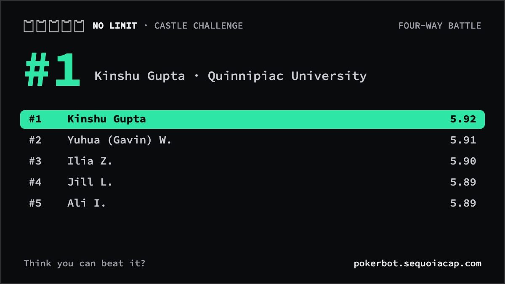

I finished first in both games of the No Limit Castle Challenge, a strategy puzzle hosted by OpenAI, Citadel Securities and Sequoia in November 2026, with about six thousand entries.

| Game | My allocation | Leaderboards after my entry landed |
|---|---|---|
| Head to Head | 4-5-36-48-7 | 1st on all 105 |
| Four-Way | 3-41-54-1-1 | 1st on 31 of 105, more than any other entry |

<figure>

<figcaption>The cards the site generated for my entry on 7 November, the night of the deadline.</figcaption>
</figure>

The leaderboard was recomputed about every half hour. These are the 105 versions published in the 45 hours after my entry appeared, which was the last update before the Boston deadline.

Two caveats. In Head to Head, first place was shared: on the deadline board with one other entry, which was one of my own measurement entries (explained below), and later with five people who copied the allocation. Four-Way is scored on randomly drawn groups, so the same entries change order every time the board is recomputed. A handful of entries sat within that noise at the top. Mine was third on the first board, first more often than any other entry (the next best had 29), and never lower than tenth.

## The challenge

You have 100 soldiers to split across five castles worth 1, 2, 3, 4 and 5 points. Everyone submits one allocation for each of two games.

**Head to Head.** Your allocation plays every other entry once. Each castle goes to whoever sent more soldiers, and a tie splits the points. Your score is your average points per opponent, out of 15.

**Four-Way.** Your allocation is dropped into a group with three other entries. Each castle goes to the one entry of the four that sent the most soldiers there. The four are then ranked by castle points, and the rank is what pays: 9 for first, 4 for second, 2 for third, 0 for last, with ties splitting.

The organisers draw 1,000,000 random groups of four from the field, and your score is your average payout, out of 9.

## Why there is no optimal answer

Every allocation loses to some other allocation. Put 48 on castle 4 and someone with 49 takes it from you and spends the difference elsewhere. So there is no best allocation in general, only a best allocation against the entries that were actually submitted.

Those entries come from people reasoning about each other. This is usually described as level-k thinking: a level-0 player splits evenly or piles onto the big castles, a level-1 player picks the best response to level 0, a level-2 player responds to level 1, and so on. Stated precisely, the field is an empirical distribution $$P$$ over the $$\binom{104}{4} = 4{,}598{,}126$$ ways to split 100 soldiers across five castles, and the task is to find the allocation with the highest expected score against an opponent drawn from it. The difficulty is that $$P$$ is not published. The leaderboard shows one number per entry, its score, and nothing about its allocation. So this is an inference problem: estimate $$P$$, or the parts of it that the score depends on, from what the leaderboard reveals. I first tried to fit $$P$$ as a whole. Then I found that Head to Head depends on $$P$$ only through five one-dimensional distributions, and that those can be measured directly.

## Approach 1: a fitted model of the field

The leaderboard publishes every entry's score but not its allocation. My first approach was to build a model of the field from those scores: a large set of candidate allocations, each with a weight, fitted so that the model reproduced the published distribution of scores and the exact scores of the few entries whose allocations I knew.

It was wrong where it mattered. A calibration entry of 20 soldiers on every castle was predicted to score between 7.7 and 8.5 and scored 6.13. Three of the first four entries the model chose came in 0.5 to 0.7 below its prediction. Its picture of castle 4 was the clearest miss: it said 41 soldiers there would beat 87% of the field. The measured figure, from the method below, was 71%.

Many different fields produce the same distribution of scores, and the model had picked one that was softer at the top than the real one. I spent two days on it.

## Approach 2: measuring the field

Head to Head scores add up castle by castle. Write $$X_c$$ for the number of soldiers a randomly drawn opponent sends to castle $$c$$. The score of an allocation $$a = (a_1, \dots, a_5)$$ is

$$
S(a) = 1 \cdot F_1(a_1) + 2 \cdot F_2(a_2) + 3 \cdot F_3(a_3) + 4 \cdot F_4(a_4) + 5 \cdot F_5(a_5)
$$

where $$F_c(x)$$ is the share of the field that $$x$$ soldiers beat on castle $$c$$, counting ties as half:

$$
F_c(x) = \Pr[X_c < x] + \tfrac{1}{2} \Pr[X_c = x]
$$

The score depends on the field only through the five functions $$F_1, \dots, F_5$$, and nothing about one castle affects another. An entry that puts soldiers on a single castle therefore reads off one value of one $$F_c$$, straight from its published score.

One example. I submitted 59-0-0-41-0, and on the final board it scored 4.468.

- Castle 1, with 59 soldiers, is a near-certain win: $$F_1(59) \approx 1$$, so 1 point.
- Castles 2, 3 and 5, with zero soldiers, tie against everyone else who sent zero there. Write $$z_c = \Pr[X_c = 0]$$, so that $$F_c(0) = z_c / 2$$. Five entries that put all 100 soldiers on one castle had already measured these: $$z_2 = 13.8\%$$, $$z_3 = 12.0\%$$, $$z_5 = 14.3\%$$.
- What is left belongs to castle 4.

$$
4 \, F_4(41) = 4.468 - 1 - \tfrac{1}{2} \left( 2 z_2 + 3 z_3 + 5 z_5 \right) = 4.468 - 1 - 0.675 = 2.793
$$

So $$F_4(41) = 2.793 / 4 = 0.70$$: 41 soldiers on castle 4 beat 70% of the field on that board (71% when I first measured it).

About eighty entries of this kind, submitted over a day, mapped all five castles. Each dot below is one of them. Set an allocation and the page computes its score from those measurements alone.

### Checking it

I had 42 other entries on the board whose value on every castle had been measured directly. For all 42, the score computed from the probes was lower than the real score by between 0.111 and 0.116. The differences between entries, which are what decide rank, were right to within 0.005.

All 42 entries

The constant gap of 0.113 is an error in my probe design that I only found while writing this up. A probe for $$F_c(x)$$ parks its other $$100 - x$$ soldiers on castle 1, and I assumed that leg always wins its 1 point, $$F_1(100 - x) = 1$$. It does not quite: a small share of the field sends even more to castle 1. Each measured value is therefore low by $$\left(1 - F_1(100 - x)\right) / c$$, and for a full allocation the errors add up to

$$
S(a) - \hat{S}(a) = \sum_{c=2}^{5} \left( 1 - F_1(100 - a_c) \right)
$$

which is about 0.03 per castle. Within the family of allocations that matter it is close to the same for every one, so it never changed which allocation looked best.

## Search

The measurements pointed at a region: almost nothing on castles 1 and 2, about 36 on castle 3, 46 to 48 on castle 4, and a handful on castle 5. My first entry there, 4-4-36-48-8, scored 9.290 and ranked 30th.

From there I searched on the leaderboard itself. Head to Head scores are exact, so submitting the neighbours of an entry (move one soldier from one castle to another) and reading their scores on the next update gives the slope in each direction with no noise. About three hours and forty entries later, 4-6-36-47-7 was first. By the evening of the deadline the field had shifted and its neighbour 4-5-36-48-7 had overtaken it, and that is the one I submitted under my name.

## Four-Way

Four-Way has no such shortcut. The payout depends on your place in the group, which depends on all five castles and all three opponents at once. The score does not split into one term per castle, and single-castle entries measure nothing useful.

I used the same neighbour search, with one change. Because the organisers score Four-Way by sampling, the same entry moves by about 0.02 from one board to the next, which is more than the difference between good neighbours. So I compared entries by their average over many boards. Over 24 boards, 3-41-54-1-1 averaged 6.003 and its two closest neighbours 6.000 and 5.997. That is a plateau, not a peak, and which entry is first on any one board is a draw among the entries on it.

## Errors

- **Two days on the model.** Ten single-castle entries on the first day would have been worth more than everything the model told me.
- **The castle 1 assumption** described above. A few entries splitting soldiers between castles 1 and 2 only would have measured it.
- **I misread the Four-Way rule** until the last night. I had assumed each castle was decided pairwise within the group. A batch of entries built on that reading moved the scores in a way that was only possible under the real rule.
- **Twenty-eight entries never appeared on the board,** and for a day I read that as delay.

I directed the work and Claude Code, running as an agent, did most of the execution: collecting every version of the leaderboard, fitting the model, and running the submit-and-measure loop overnight.

<link rel="stylesheet" href="/assets/castle/predictor.css">

